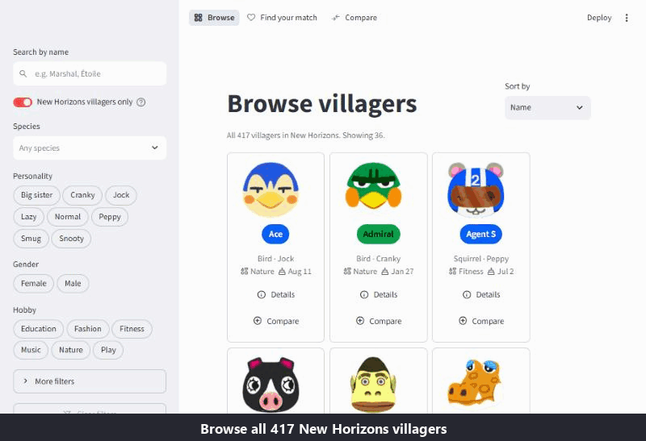

# Villager Explorer

[](https://github.com/1Robert1Business1/villager-explorer/actions/workflows/tests.yml)

A Streamlit app for exploring the Animal Crossing villagers: browse and filter all 490, find the ones that suit you, and compare them side by side.

**Live app: [villager-explorer.streamlit.app](https://villager-explorer.streamlit.app)**



The app runs on free hosting that sleeps after a quiet period. If you see the sleep page, click the button to wake it; that takes around 30 seconds.

**This is an exploration tool on a static dataset, not an analytical study.** It doesn't produce findings. It makes a fixed snapshot of the villager data quick and pleasant to search.

## Overview

Villager Explorer has three views built on one filtering engine. **Browse** filters the full roster. **Find your match** asks a few questions and ranks villagers by how many answers they fit. **Compare** puts up to four villagers side by side. A comparison started in one view carries over to the others, and a Compare page's address can be shared.

The data is a committed snapshot of [Nookipedia](https://nookipedia.com)'s villager tables, cleaned and validated when it loads. Images come from Nookipedia's image host at runtime and are processed on the server before they reach the browser. The project's aim was a small app built to production habits: tested, monitored once deployed, and careful with untrusted data.

## Features

- **Browse and filter.** Search by name (accents optional: "etoile" finds Étoile), and filter by species, personality, gender, hobby, star sign, birthday month, favourite style and favourite colour. Choices within a filter widen the results (Cat *or* Dog); different filters narrow them. Sort by name, birthday or species. A toggle covers either the 417 New Horizons villagers or all 490.
- **Details pop-up.** Each villager's profile, favourites, catchphrase, quote and game appearances, with a link to their Nookipedia page.
- **Find your match.** Answer any of five questions (species, personality, hobby, styles, colours). Villagers are ranked by how many answers they fit, and each card says which answers matched and which didn't.
- **Compare.** Up to four villagers in one table. Rows that are the same for everyone are highlighted, and styles and colours they all share are ticked. Villagers who share a name are told apart by species.
- **Selections persist across views** for the session. Share links are rebuilt from known villager keys, so text in a link is never displayed.
- **Readable in light and dark themes.** Name chips use each villager's colour from the wiki, with black or white text chosen to meet WCAG AA contrast. Tests check every chip in the dataset and all faded text in both themes.

## Engineering Highlights

- **Server-side image pipeline with graceful fallback.** Images are downloaded on the server with size and pixel caps, re-encoded as small thumbnails and cached. Cards appear straight away and images fill in as they arrive. Any failure (a dead link, a timeout, a corrupt file) shows a leaf placeholder, never a broken-image icon.
- **Escaped rendering of all dataset text.** No dataset text is rendered as Markdown. Names, quotes and catchphrases are HTML-escaped into `st.html`. Category values, which become widget labels, must be plain words when the data loads, so a bad snapshot fails loudly instead of rendering. Tests pass hostile strings through every renderer.
- **SSRF host allowlist.** The image fetcher only makes HTTPS requests to one allowlisted host (`dodo.ac`) on the default port, and never follows redirects. A bad URL in the dataset can't point the server at internal addresses.
- **CI on Linux and Windows.** `tests` runs the suite on every push, on Ubuntu with Python 3.12 (the deployed version). `tls-live` runs live certificate checks on Ubuntu and Windows on every push to `main` and weekly. The Windows run matters because thread-safety differs by platform: don't share truststore contexts across threads; see [truststore#209](https://github.com/sethmlarson/truststore/issues/209). Two guards keep that job honest:
  - **Silent-green guard.** The run fails if the network tests were skipped rather than run. On its own, pytest reports success when every test is skipped.
  - **Canary.** On Windows, a mutation test checks that the issue still reproduces, which proves the guard still tests something.

  Actions are pinned to commit SHAs and run with a read-only token.
- **`/diagnostics` as deployment monitoring.** An unlinked page reports what is actually running on the host:
  - Python and package versions
  - memory use against the container limit
  - image-cache size and timings
  - a rate-limited TLS self-test, which passes only if images load and untrusted certificates are rejected
- **The pyarrow pin.** pyarrow 25.0.x can crash when first imported on a thread that later exits ([apache/arrow#50471](https://github.com/apache/arrow/issues/50471)), and Streamlit runs scripts that way. Streamlit Community Cloud swaps it for 24.0.0 at deploy. `requirements.txt` pins 24.0.0 so local, CI and Cloud all run the same version.

## Limitations

- **Static snapshot.** The data is frozen at 28 September 2026. New villagers or wiki corrections won't appear until the snapshot is rebuilt.
- **Runtime dependence on the image host.** Images load live from Nookipedia's host. If it is slow or down, cards show placeholders; everything else still works.
- **Free-tier sleep.** After a quiet period the app sleeps, and the next visit takes around 30 seconds to wake it.
- **Find your match is New Horizons only.** Hobby, styles and colours exist only for the 417 New Horizons villagers, so the 73 from earlier games can't be matched fairly. They still appear in Browse and Compare.
- **Find your match scores every answer equally.** A species answer counts as much as a colour answer, and there is no way to mark one as essential. Ties are listed alphabetically.

## Tech Stack

Python · Streamlit · Pandas · PyArrow · Pillow · Requests · truststore · pytest · GitHub Actions · Streamlit Community Cloud

## Run Locally

Requires Python 3.11 or newer (for Pandas 3). The app is developed and deployed on 3.12.

### Windows (PowerShell)

```powershell
git clone https://github.com/1Robert1Business1/villager-explorer.git
cd villager-explorer
py -3.12 -m venv .venv
.\.venv\Scripts\Activate.ps1
python -m pip install --upgrade pip
pip install -r requirements.txt
streamlit run app.py
```

### macOS / Linux

```bash
git clone https://github.com/1Robert1Business1/villager-explorer.git
cd villager-explorer
python3.12 -m venv .venv
source .venv/bin/activate
python -m pip install --upgrade pip
pip install -r requirements.txt
streamlit run app.py
```

### Tests

```powershell
pip install -r requirements-dev.txt
pytest                              # offline suite
$env:NETWORK_TESTS="1"; pytest      # also runs the live TLS checks (needs internet)
```

On macOS and Linux, use `NETWORK_TESTS=1 pytest` for the live checks.

## Structure

- `app.py` — entry point and top navigation
- `views/browse.py` — Browse and filter
- `views/match.py` — Find your match
- `views/compare.py` — Compare, including share links
- `views/diagnostics.py` — deployment monitoring at `/diagnostics` (not linked in the navigation)
- `src/data.py` — loads, cleans and validates the snapshot (cached)
- `src/filters.py` — the shared filtering engine, Find your match ranking and sort orders
- `src/compare.py` — Compare selection rules, share-link parsing, comparison rows
- `src/images.py` — image fetch, validate, resize and cache, with placeholder fallback
- `src/components.py` — cards, the progressive grid, the details pop-up and the comparison table
- `scripts/build_dataset.py` — rebuilds `data/villagers.csv` from Nookipedia
- `data/villagers.csv` — the committed snapshot (490 villagers)
- `assets/` — placeholder image and the demo GIF
- `tests/` — unit, end-to-end (Streamlit AppTest), security and privacy tests
- `.github/workflows/` — `tests` (every push) and `tls-live` (Linux and Windows, pushes to `main` and weekly)
- `PROJECT_BRIEF.md` — the original spec and build plan

## Future Work

- **Weighted answers in Find your match,** letting a user mark an answer as essential rather than counting every answer equally.
- **Scheduled snapshot refresh.** A workflow that rebuilds the dataset and opens a pull request when Nookipedia's data has changed.
- **Persistent thumbnail cache,** so a cold start doesn't download every image from the host again.

## Dataset

`data/villagers.csv` holds 490 villagers: 417 from New Horizons and 73 who appear only in earlier games. It was built from [Nookipedia](https://nookipedia.com)'s public Cargo tables on 28 September 2026. The app never fetches data live; only images load at runtime. To rebuild the snapshot:

```bash
python scripts/build_dataset.py
```

Notes for Animal Crossing fans:

- **Catchphrases** are the New Horizons ones wherever a villager appears in New Horizons, and the series-wide catchphrase otherwise. A few villagers have different ones (Pudge says "pudgy" in New Horizons, "golly" series-wide).
- **The 73 earlier-game villagers** have no hobby, favourite styles, favourite colours or favourite song on Nookipedia. The app shows those fields as "Unknown" rather than dropping the villagers.

Villager data courtesy of Nookipedia, licensed [CC BY-SA 3.0](https://creativecommons.org/licenses/by-sa/3.0/). Images are loaded from Nookipedia's image host and are not stored in this repository.

---

*A fan-made project, not affiliated with or endorsed by Nintendo. Animal Crossing is a trademark of Nintendo.*
